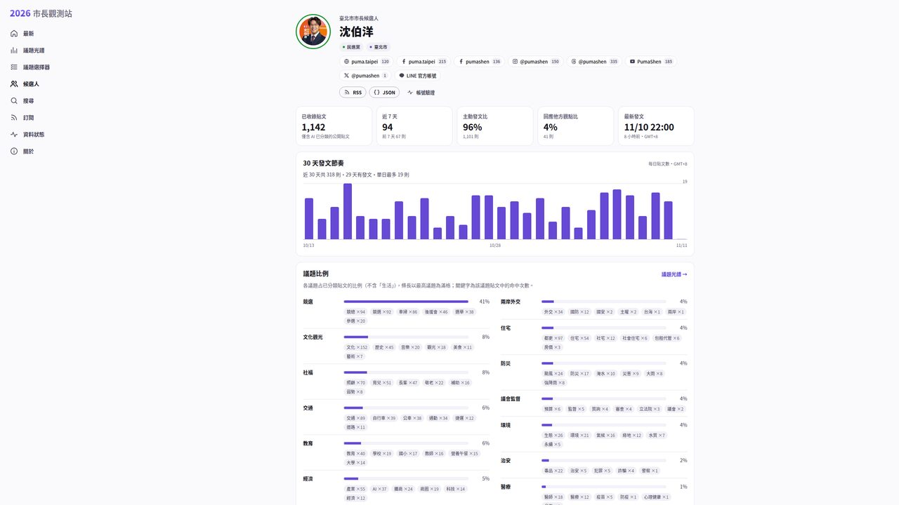
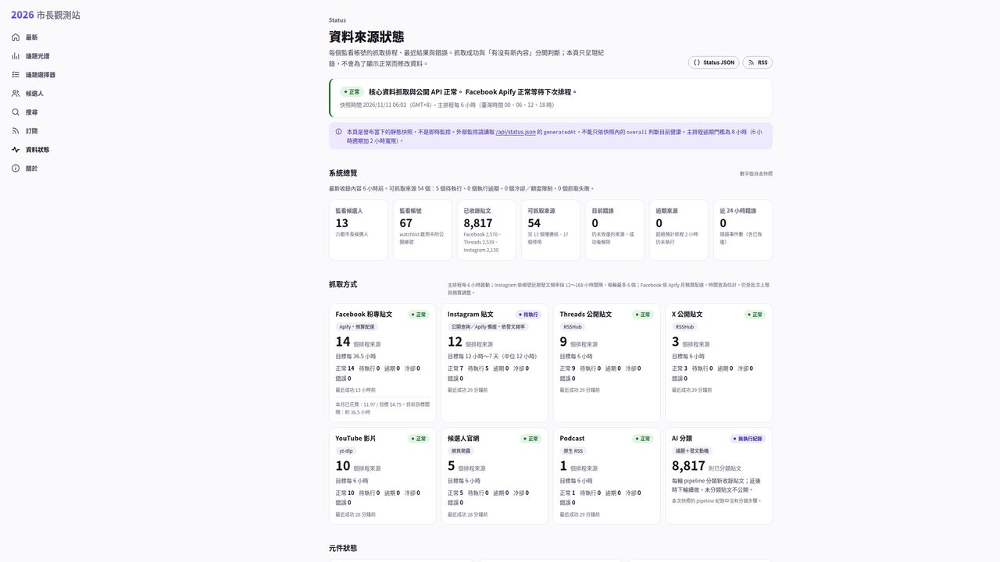
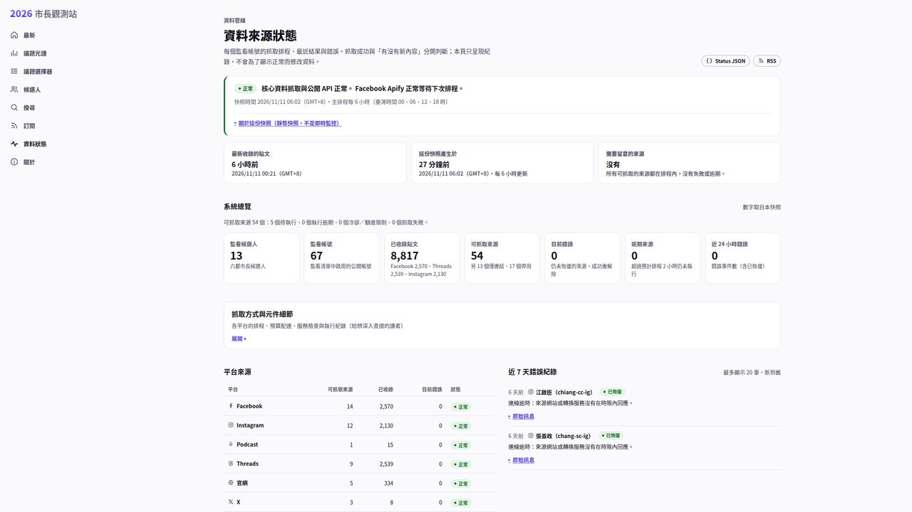

# Design review results

Every round used a fresh claude-proxy Claude Opus 5.5 judge (effort high) on the unchanged `../brief.md`
(SHA-256 `e0618776…ec08606`), blind A/B/C sets: baseline (`main`, shot once), the round's new build, and a fixed
reference set (READr, Ground News, Bluesky; shot once). Raw judge text is in `r1.md` … `r10.md`; the A/B/C mapping
was revealed only after each review.

| Round | Baseline | New | Reference | New − baseline |
|---:|---:|---:|---:|---:|
| 1 | 7 | 7 | 6.5 | 0 (new = baseline, calibration) |
| 2 | 7 | 8 | 8 | +1 |
| 3 | 6.5 | 8 | 6 | +1.5 |
| 4 | 6.5 | 7.5 | 7 | +1 |
| 5 | 6.5 | 7.5 | 6.5 | +1 |
| 6 | 6 | 7.5 | 6 | +1.5 |
| 7 | 6.5 | 7.5 | 7 | +1 |
| 8 | 7 | 8 | 6.5 | +1 |
| 9 | 6.5 | 8 | 7.5 | +1.5 |
| 10 | 6.5 | 8 | 7 | +1.5 |

Stage 1 stopped at its 10-round cap: the new build never reached 9, so the council stage (Opus 5.5 / Fable /
GPT-6.1 Sol) was not started.

## Score inflation / drift

- The baseline and reference images are byte-identical in every round, yet their scores moved: baseline 6–7,
  reference 6–8 (round 2 → 3 the reference fell 2 points). The judge's absolute scale drifts by about ±1, so
  the new − baseline gap within a round is the meaningful number, not the absolute new score.
- Round 1 is a clean calibration: two identical sets got identical scores (the judge also noticed they were
  byte-identical).
- The gap held at +1 to +1.5 from round 2 on; the new build's absolute score plateaued at 7.5–8 while
  the judge kept finding new, smaller issues each round (e.g. round 5 found a real regression — post actions
  wrapping per character — introduced in round 4).
- Several judges repeated baseline issues as if they were in the new set (they read sets in random order);
  the maintainer checked 1:1 crops whenever a clipping or contrast claim was made (rounds 4 and 5).
- Round 7's judge reported losing early screenshots from its context (200 images); from round 8 the task
  message (not the brief) asks the judge to take short notes per page.
- The Ground News homepage reference captured a paywall interstitial; it was kept as-is so reference scores
  stay comparable across rounds.

## Before / after (1440p crop and 390px phone, light)

| Page | Before (`main`) | After |
|---|---|---|
| Home |  |  |
| Search |  |  |
| Candidate |  |  |
| Status |  |  |
| Home (phone) |  |  |
| Search filtered (phone) |  |  |
| Status (phone) |  |  |
