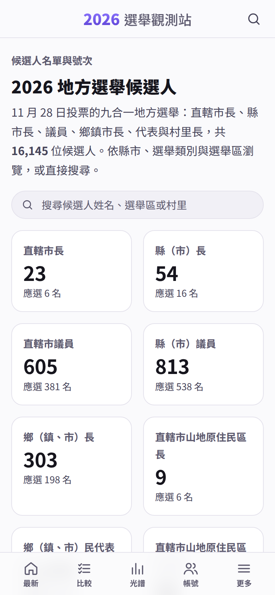
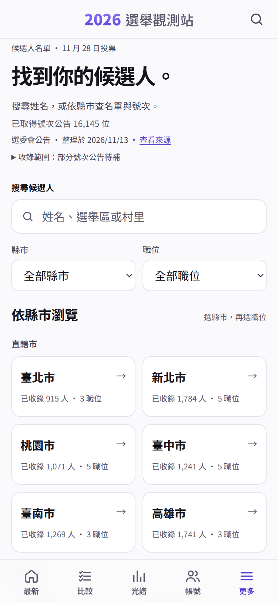
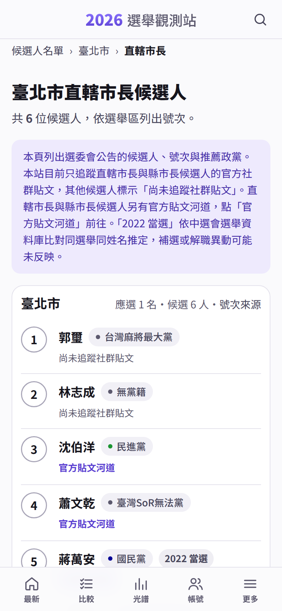
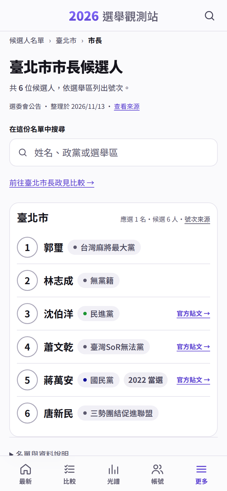

# 候選人名單 UI/UX hill climb · 2026-11-16

發布版平均 **8.1125 / 10**。四輪修正後達到使用者要求的至少 8 分。此為模型設計評估，並非真實使用者研究。

## 評估方式

每輪以相同八個維度，各評 1–10 分（可一位小數），八項等權平均。使用 `sky-quality`（閘道回報 `gpt-6.1-sol`）、reasoning medium、結構化 JSON 輸出。每輪為獨立請求，不提供先前分數、輪次、通過門檻或期望分數。完整回覆保存在同目錄 JSON。

固定截圖情境：1440×1000 桌機總覽；390×844 手機總覽、臺北市、臺北市長、中山區里長、姓名搜尋。第三、四輪另附空結果截圖。搭配各輪已實測的操作紀錄；基準輪以截圖為主，因此不同輪的互動證據完整度不同。

評分尺度：1–3 嚴重阻礙；4–5 明顯困難；6 可用但有重大摩擦；7 良好仍需修正；8 成熟易用僅小缺點；9 非常出色；10 罕見完美。要求評審根據可見證據評估，不推測未展示互動，並指出每項具體缺點與三項改善優先順序。

| 維度 | 修改前 | 第一輪 | 第二輪 | 第三輪 | 第四輪（發布版） |
|---|---:|---:|---:|---:|---:|
| 初次理解與資訊架構 | 7 | 7.5 | 7.8 | 7.8 | 8 |
| 查找效率與操作入口 | 5.5 | 8 | 7.7 | 8 | 8.3 |
| 版面與視覺層級 | 6 | 6.5 | 7 | 7 | 7.5 |
| 字體與資訊掃讀 | 7 | 7 | 7.8 | 7.7 | 8 |
| 手機適應與觸控 | 6 | 7 | 5.5 | 8 | 8.2 |
| 狀態回饋與錯誤復原 | 5.5 | 8.5 | 8.2 | 8.6 | 8.7 |
| 一致性與可及性 | 6.5 | 6.5 | 6.8 | 7.8 | 8 |
| 資料來源與信任 | 7 | 8 | 8 | 8 | 8.2 |
| **平均** | **6.3125** | **7.3750** | **7.3500** | **7.8625** | **8.1125** |

## 修正內容

1. 第一輪：搜尋與縣市先行，統計折疊；加入縣市／職位交叉篩選、在地搜尋、空結果、錯誤重試、分批載入與網址還原。
2. 第二輪：縮短頁首、把 JSON 移至次要位置、補整理日期與來源、村里選區跳轉、更多選單目前區域標示。此輪桌機標籤修正造成手機選單溢出，評分未上升。
3. 第三輪：修復篩選欄溢出；比較入口改為文字連結；補充公告收錄範圍，強化鍵盤焦點、狀態宣告與追加結果焦點。
4. 第四輪：候選人與官方貼文改為同列，縮短名單行高，統一市長／市議員等名稱，縣市卡直接標明「已收錄」。

## 議題選擇整合

- 政見比較可複選議題、移除已選議題、顯示全部、重設空結果；篩選條件可分享。
- 舊 `/policy-match/#c=…` 將問卷選項展開為對應議題並導向 `/compare/taipei/?topics=…`；既有單一 `topic`、搜尋、候選人與證據錨點仍可使用。
- 移除重複導覽入口；候選人名單保留在手機「更多」中，沒有加入底部 tab。
- 保留舊問卷 API 相容資料，保留全部 16 類議題、999 個政策問題與 213 個原文標題。

## 驗證

- 184 項離線測試通過；新增舊分享連結轉換、參數保留、未知選項與腳本逃逸回歸測試。
- 全部 JavaScript 語法通過，正式輸出及來源覆蓋驗證通過。
- 姓名查詢、縣市＋職位篩選、村里搜尋／跳轉、無結果、清除、失敗重試、分批載入及網址還原實測。
- 窄版與桌機檢查：320、390、768、1440 CSS px；主要名單及比較頁共 20 個版面無文件水平溢出。
- Tab 焦點可見、搜尋結果有 live status；追加資料焦點進入第 41 筆，選區跳轉焦點移至目標。最後一張村里卡可完整捲出手機導覽。
- 亮色文字對比抽測：來源 8.89:1、搜尋標籤 17.38:1、縣市次要文字 6.75:1。

尚未進行實體手機虛擬鍵盤、真實讀屏器或使用者研究；整體可及性不作認證。發布版評審仍建議改善長名單密度、各縣市／職位的收錄完整度呈現，以及手機目前位置提示。

## 前後截圖

### 手機總覽

修改前：

發布版：

### 手機市長名單

修改前：

發布版：

